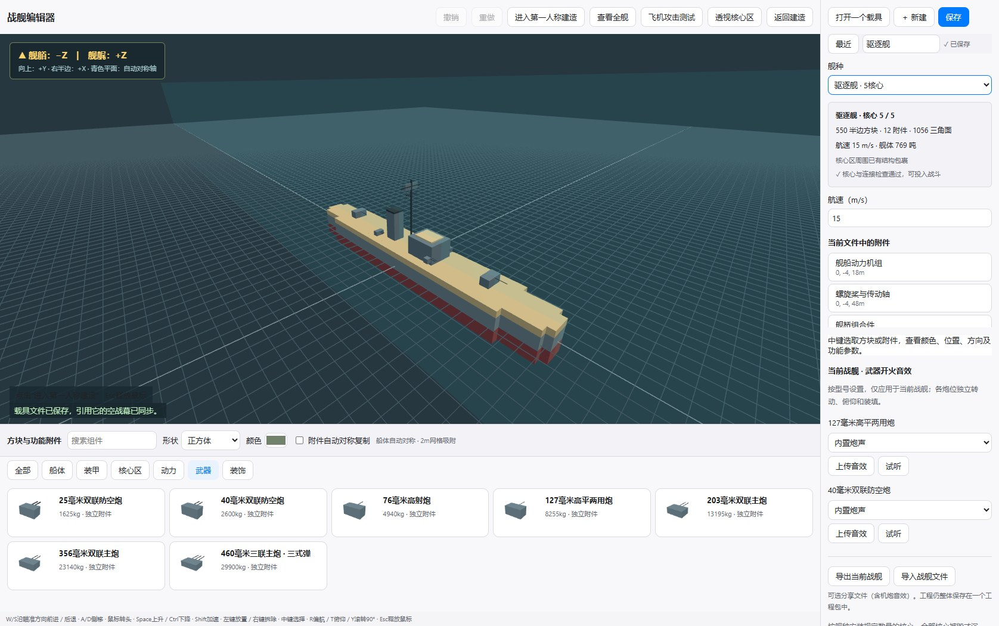
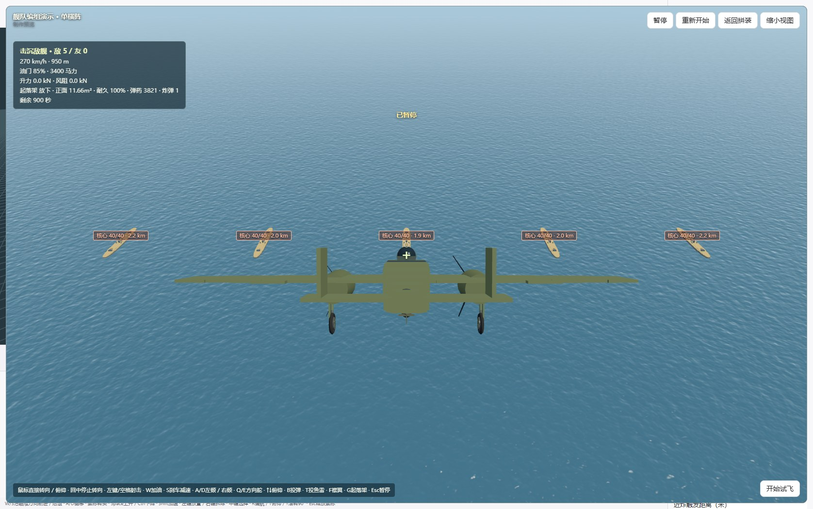

# 公民文艺生产综合自动化系统 · VRM Galgame

使用 VRM、FBX、MMD 人物和三维场景制作视觉小说，编排对白、分支、事件与空战，导出离线 Windows 游戏。

**当前版本 0.0.70**：[下载正式版](https://github.com/2396846264/-vrm-galgame-editor/releases/tag/v0.0.70) · [本次更新与截图](RELEASE_NOTES.md) · [战舰与舰队使用说明](docs/naval70-guide.md) · [完整功能](docs/features.md)

## 0.0.70 更新

- 飞机、战舰分别在独立编辑器窗口建造。战舰提供六种舰种原型，以及船体、装甲、核心区、动力、武器和装饰分类。
- 玩家驾驶飞机攻击 AI 战舰；友敌舰队必须按单纵阵、复纵阵、轮型阵、单横阵或梯形阵共同航行，保持队位和间距。
- 战舰依靠装甲保护内部核心，核心全部摧毁后沉没。支持高爆炸弹、穿甲炸弹、航空鱼雷及舰载防空。
- 炮塔具有转速和加速度；支持近炸、定时、碰炸引信和独立的三式对空弹效果。每艘载具的不同炮型可分别配置音效。
- 战舰可导出为含引用音效的 `.vrmship` 分享文件；日常剧情、人物、载具和声音仍统一保存在一个 `.vrmg` 工程包。
- 同步公开 0.0.53–0.0.69 的语言、游戏皮肤、实时预览、幕名动画、场外模型头像及空战开场对白等更新。

## 创作能力

| 模块 | 功能 |
| --- | --- |
| 剧情 | 幕、台词、配音、音效、动作表情、镜头、分支、事件和视频 |
| 人物 | VRM / FBX / MMD、动作与 VMD、口型、自动眨眼、自然视线、动态头像和物品绑定 |
| 场景 | 独立环境、模型与图片、分组、吸附、灯光、天空、海面 / 流水 / 瀑布 |
| 载具 | 飞机与战舰独立窗口、对称建造、异形方块、部件参数与单载具分享 |
| 空战 | 飞机操作、友敌 AI、舰队、防空、炸弹、鱼雷、任务及剧情出口 |
| 游戏界面 | 液态玻璃、粉白星光、青柠浅色 / 深色皮肤，实时预览与角色姓名颜色 |
| 物品与资料 | 奖励、数量条件与消耗、背包、鉴赏、角色故事和 PDF 资料库 |
| Agent / MCP | 本地编辑器接口、草稿、资源与模型检查、场景搭建、保存和导出 |
| 工程 | 素材归类、撤销重做、存读档、试玩与 Windows 离线游戏导出 |
| 编辑器语言 | 简体中文、English、日本語，可在设置切换 |

## 开始使用

1. 从 [Releases](https://github.com/2396846264/-vrm-galgame-editor/releases/tag/v0.0.70) 下载安装包，或解压便携 ZIP 后运行 `VRMGalgame.exe`。需要 Windows x64 和 Microsoft Edge WebView2 Runtime。
2. 新建或打开 `.vrmg` 工程，导入自己有权使用的人物、场景、动作与声音。
3. 通过“编辑器 → 载具编辑器”选择飞机或战舰，在空战幕设置友敌载具、舰队及任务。
4. 需要 Agent 时，在“剧情助手”启用本地接口并复制 MCP 配置；更新程序后重新复制配置。
5. 示例 ZIP 包含六种程序生成战舰和一架轰炸机的分享文件，不附第三方人物素材。

## 实现边界与开发

玩家只驾驶飞机；战舰由 AI 编队控制。飞行、装甲、防空和进水沉没表现采用游戏近似规则，尚未实现航母舰载机起降及真实流体浮力。空战读档从任务检查点重开。当前提供 Windows 版。

开发使用 Node.js 22+ 与 .NET 10，见 `scripts/build-windows.ps1`。公开源码使用独立开发身份；正式加密工程请使用正式版，并保留自己的工程与身份备份。第三方依赖说明见 `licenses/`。
