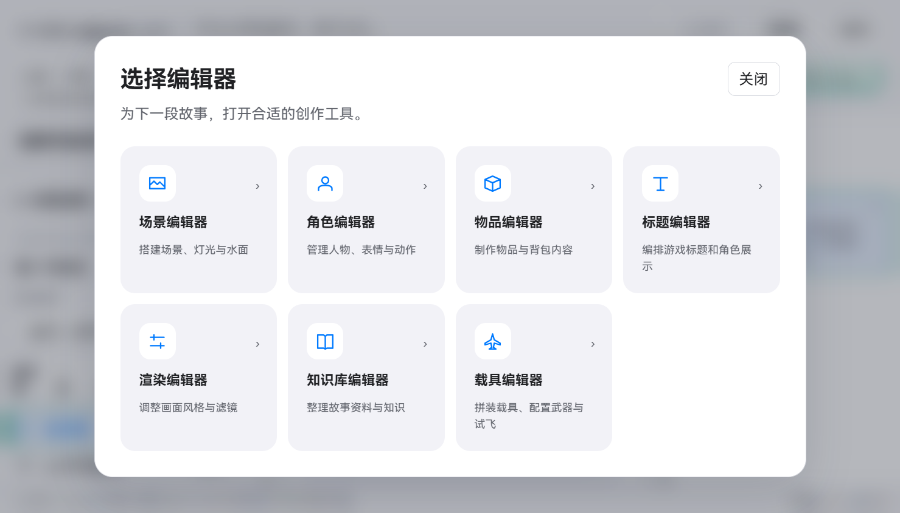
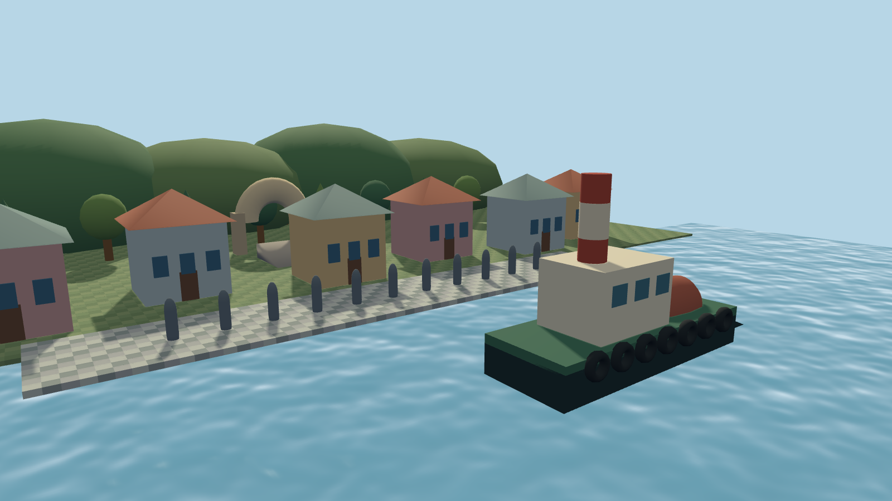
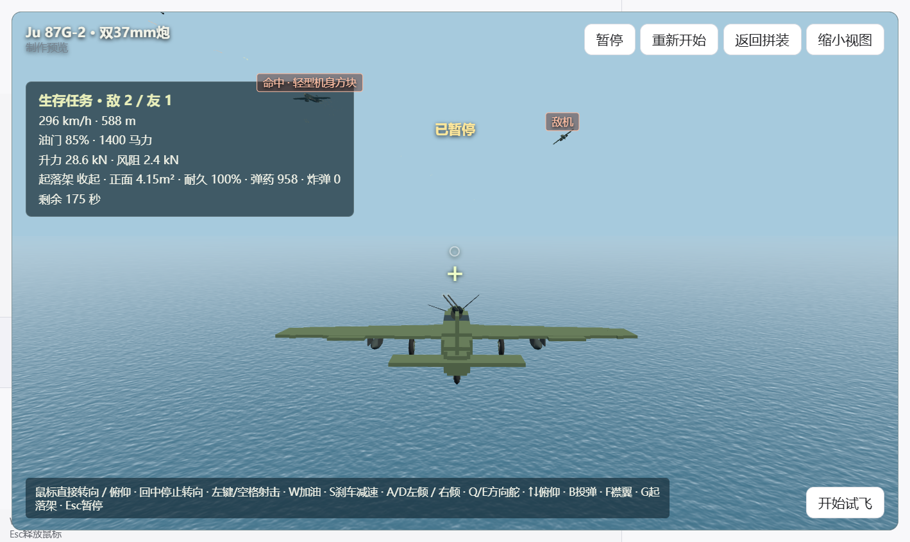

# VRM Galgame 编辑器

使用VRM、FBX、MMD人物与三维场景制作视觉小说，加入视频、事件和空战小游戏，导出离线Windows游戏。

**当前版本0.0.52**：[下载正式版](https://github.com/2396846264/-vrm-galgame-editor/releases/latest) · [图文完整功能](docs/features.md) · [发布说明](RELEASE_NOTES.md) · [更新记录](CHANGELOG.md)

## 当前能力

| 模块 | 功能 |
| --- | --- |
| 剧情与对白 | 幕、台词、配音、音效、镜头、30人站位、动作表情、分支与事件 |
| 人物 | VRM/FBX/MMD，动作重映射、VMD、口型、绑定物品、动态头像、详情与MMD物理 |
| 活人感 | 强制低频眨眼、自然乱瞟、偶尔看其他角色，多人随机错峰 |
| 场景 | 独立环境文件、模型/图片、分组层级、吸附、灯光、天空、镜头、水面/流水/瀑布 |
| Agent与MCP | 39个本地工具，读写工程、编排粗稿、检查模型、批量布景、截图、保存和导出 |
| Agent专用几何体 | 9种形状、独立颜色、批量铺设，最多3万块；仅接管场景编辑器期间开放 |
| 载具 | 单机文件式编辑，12.5cm网格、半边对称、异形块、预制附件、四款螺旋桨样机 |
| 空战 | 海面背景、友敌AI、油门/制动/倾斜飞控、炮塔与弹道、活动起落架、任务与剧情出口 |
| 物品与知识 | 奖励、数量条件与扣除、背包、鉴赏、角色故事解锁、PDF知识库 |
| 标题/UI/渲染 | 多人物标题、四套游戏UI、天气、72项自定义渲染参数与画质选项 |
| 工程与发布 | 素材归类、保存/另存为、撤销重做、试玩、存读档、Windows离线游戏导出 |

## 0.0.52重点

- 新增仅Agent接管场景编辑器时可用的彩色几何体搭建MCP，支持9种形状、批量铺设、独立颜色和保存重开。普通用户界面隐藏创建与单块编辑入口。
- 修复载具零件文字裁切、幕列表新增按钮拆行。
- 包含0.0.51的更新：第一人称建造沿完整瞄准方向移动，W油门/S制动/A-D倾斜、鼠标直接操纵的新飞控，海上空战和平台起飞，场景水面/流水/瀑布，跟随系统明暗的新编辑器界面。
- 保留VRM/FBX/MMD人物、强制低频眨眼与自然视线、30人站位、剧情分支、背包、知识库、渲染、标题、39个MCP工具及Windows游戏导出。
- 通过真实MCP试建港口与庭院，附工程、截图和逐项对照。

## 上手

1. 从[Releases](https://github.com/2396846264/-vrm-galgame-editor/releases/latest)下载安装包或便携ZIP。Windows x64，需要Microsoft Edge WebView2 Runtime。
2. 运行`VRMGalgame.exe`，新建或打开`.vrmg`工程。导入自己的模型、动作、图片和声音。
3. 在主界面编排剧情，通过“编辑器”进入角色、场景、载具等独立页面，试玩后导出游戏。
4. 使用Agent时，在“剧情助手”开启本地接口并复制MCP配置；更新程序后重新复制配置。
5. 示例ZIP提供自行搭建的场景工程，打开后可在场景编辑器中选择港口或庭院。

## 专题说明

[完整功能](docs/features.md) · [Agent几何体](docs/agent-geometry.md) · [场景试建对照](docs/scene-comparison.md) · [海上空战与水面](docs/ocean-editor.md) · [载具建造](docs/vehicle-editor.md) · [自动眨眼](docs/auto-blink.md) · [自然视线](docs/natural-gaze.md) · [MCP编辑](docs/MCP编辑功能.md)

## 当前边界

载具目前支持螺旋桨飞机，未实现坦克、战舰和移动航母；海上平台没有弹射器或阻拦索。飞行与武器为游戏近似模拟，水面为视觉组件。几何体场景保留结构和配色，尚未达到手绘背景的纹理细节。空战读档从任务检查点重开。当前提供Windows版，Android导出已取消。

## 开发构建

使用Node.js 22+与.NET 10，运行`scripts/build-windows.ps1`。公开源码不含正式构建的私有凭据；开发构建使用独立身份，日常使用正式加密工程请下载正式版，保留自己的工程与开发身份备份。第三方依赖说明见`licenses/`。
