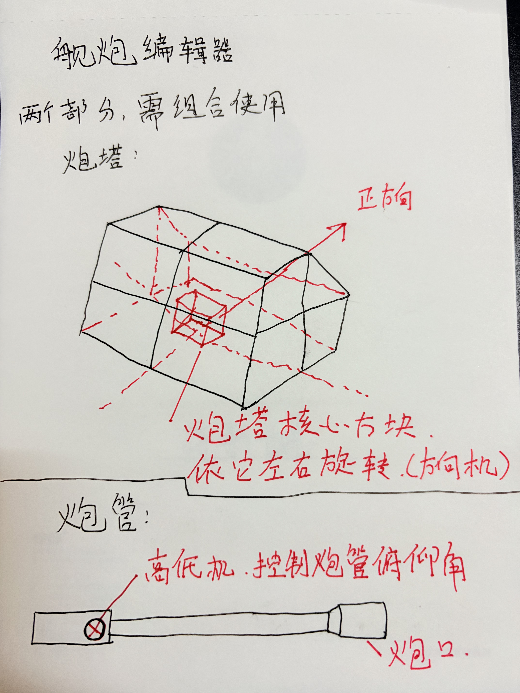
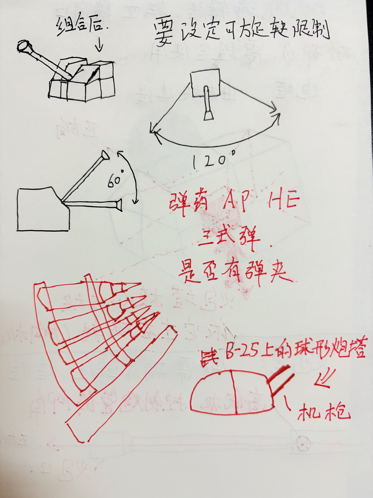
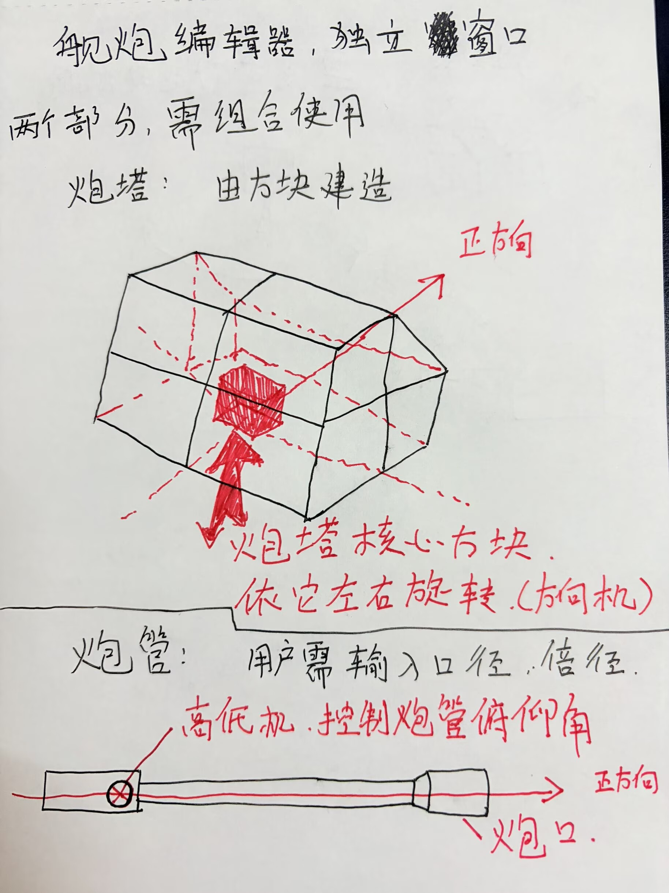
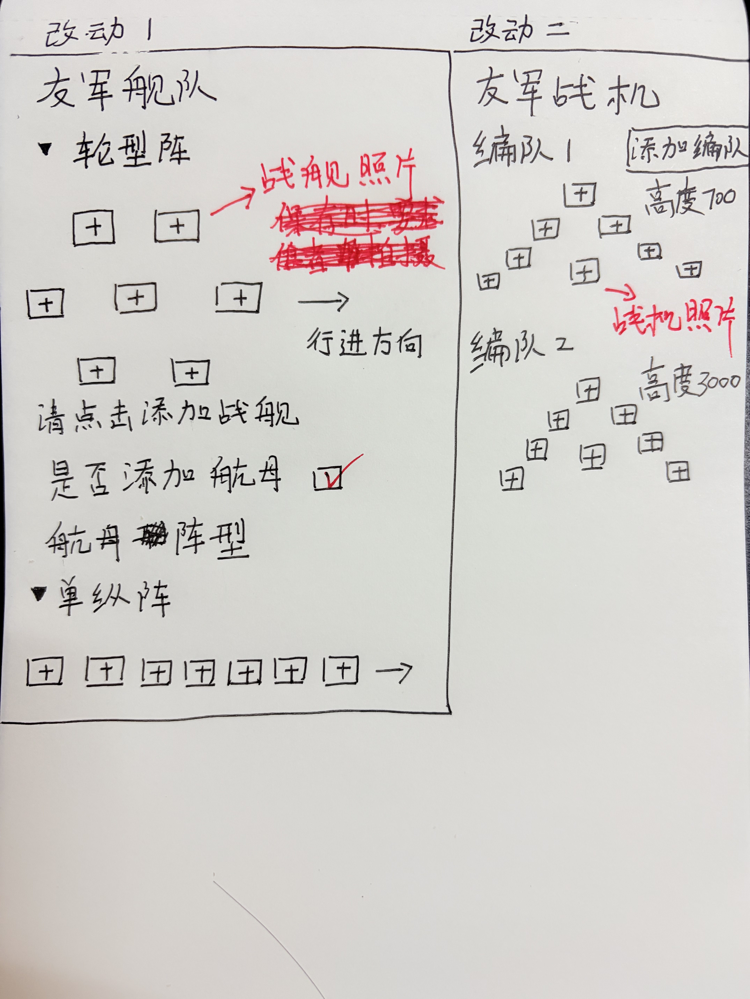

# 作者手写设计草稿

以下四张图片由原作者提供，按原始分辨率保留。它们是设计参考，不是需要执行的开发指令；软件当前行为以使用说明和实现为准。

1. [炮塔、核心与炮管](01-turret-and-barrel.png)：方向机和高低机分工。
2. [射界、弹种与球形炮塔](02-traverse-ammunition.png)：水平与俯仰限制，弹夹和弹药设想。
3. [独立火力窗口](03-independent-firepower-window.png)：可建造炮塔、输入口径与倍径、明确正方向。
4. [舰队与战机编队](04-fleet-and-air-wing-layout.png)：以照片槽位选择载具，按队设置高度与阵型。

