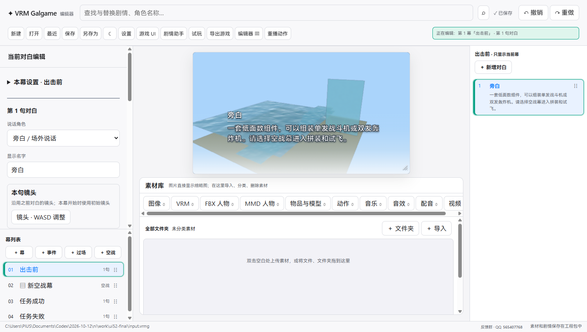
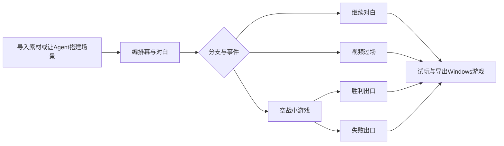
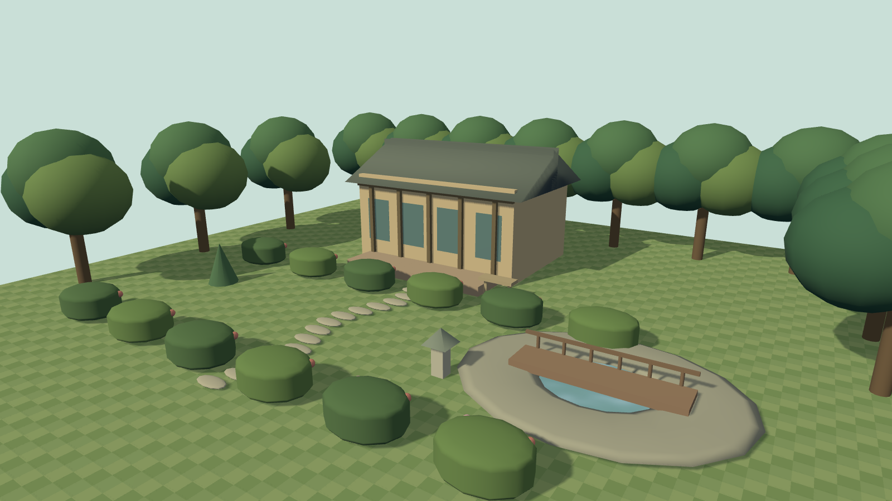
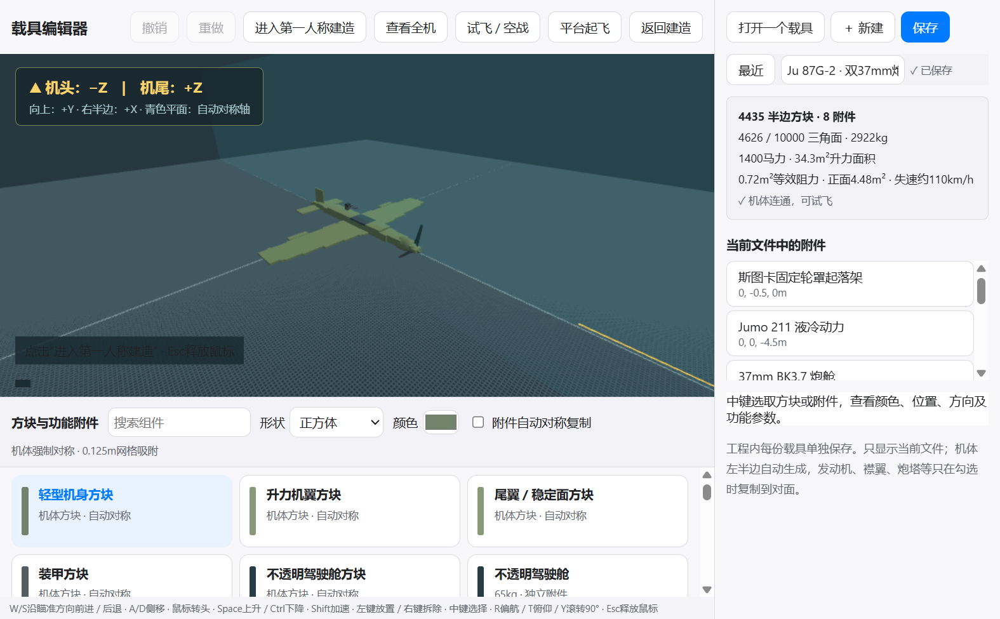

# VRM Galgame 编辑器 · 0.0.52 完整功能

用三维人物、场景、动作和声音制作可试玩、可导出的视觉小说，也可以把空战小游戏作为剧情中的一幕。

以下为0.0.52当前实际能力。截图来自本地运行的程序；载具与几何体示例使用自行生成的模型，没有把第三方人物素材打包进公开下载。

## 创作入口与界面

主界面负责幕、对白、分支和事件。角色、场景、物品、标题、渲染、知识库和载具都有对应的独立编辑页面。选择编辑器时以图标、名称与用途说明展示入口。

黑白灰底色配蓝色强调，默认跟随系统明暗，也可固定日间或夜间。工具栏、属性区和卡片采用统一间距与圆角，适配Windows桌面和较小窗口；保留键盘焦点、快捷键与减少动画偏好。0.0.52修复了零件名称与说明裁切、幕列表新增按钮将中文拆行的问题。

## 剧情、对白、分支和事件

- 新建、打开、最近工程、保存、另存为；用`.vrmg`工程包保存剧情、角色、资源和环境。
- 幕与对白可新增、复制、删除、排序；支持撤销、重做及查找替换可见文字。
- 对白可设置旁白或说话角色、显示名字、台词、配音、音效、人物动作、表情和镜头。音乐与配音分开管理，配音对应具体对白。
- 每个对白可编排多人站位，最多30个角色位置；设置人物大小、XYZ偏移、转身、俯仰及显示的绑定物品。
- 镜头支持沿用前句或单句调整，也可设置幕的初始镜头。可试玩当前内容，预览角色、场景和声音的组合。
- 分支选项可跳转到指定幕；可要求持有一定数量的物品，并选择是否扣除。条件不足时选项不可用。
- 事件支持新闻、宣战、重大事件等版式，设置标题、正文、图片、国旗、音乐和音效；可加入MP4过场。
- 空战也是独立剧情节点，可指定胜利与失败后继续哪一幕，构成“对白—小游戏—不同结局”的流程。

## 三维人物、动作与活人感

### 支持的模型与动画

- 人物支持VRM、FBX人物、MMD的PMX/PMD；MMD需要同时提供模型使用的贴图。
- 动作可使用FBX/Mixamo重映射与MMD的VMD。角色专属动作、通用动作及配音分别组织。
- 动作可以调整循环、起止帧、结束后待机或保持、原地或自由移动、脚部固定方式，并与表情、对白口型组合。
- 可检查实际骨骼与表情名称；模型带有的能力按模型结构使用，不凭空给缺少骨骼或表情的模型补出对应功能。
- 支持角色的绑定物品：选择骨骼并调整物体位置、旋转与缩放，可随角色动作显示。
- 角色可生成PNG头像，使用动态头像展示人物；管理名字、简介、角色故事与解锁条件、详情页待机动作。
- MMD头发与衣饰物理读取模型的刚体、碰撞和连接设置；有性能优先、完整更新与关闭选项。

### 强制开启的自动眨眼与自然视线

| 能力 | 当前行为 |
| --- | --- |
| 自动眨眼 | VRM、MMD人物低频随机触发，常规随机间隔约6～12秒，没有关闭选项 |
| 偶尔乱瞟 | 随机等待约8～16秒，小幅移开视线、短暂停留、平滑回正 |
| 看同场角色 | 偶尔选择当前在场、距离与方向合适的其他角色；每个人物有独立的较长冷却 |
| 多人错峰 | 每个人独立计时；自动眨眼同一时刻最多一人，自动偏移视线最多两人，并错开开始时刻 |
| 原动作优先 | 原生动作、VMD眼神、明确注视目标和手动视线表情优先，自动效果作为临时层 |
| 头像同步 | 人物与动态头像共享眼神，暂停时自动效果计时暂停 |

VRM使用原生lookAt；MMD使用左右眼骨骼及继承关系。模型没有可用的眼球控制结构时保留原样。多人限制只针对自动效果，不限制作者刻意编排的同步动画。

详见[自动眨眼](auto-blink.md)、[自然视线](natural-gaze.md)、[MMD支持](MMD支持与物理.md)。

## 场景环境编辑器

环境以独立文件式入口管理：打开某个环境时只编辑该场景，可以给幕和标题引用。同一工程可保存多个可复用环境。

- 导入GLB等场景模型、PMX/PMD场景模型及图片平面；远景图可使用镂空处理。
- 物体支持平移、旋转、等比缩放、可见性、复制粘贴、多选、分组、层级重挂载和网格吸附。
- 支持地面、灯光、天空背景与初始镜头；阴影投到实际场景物体上，灯光和补光可调整。
- 可以用参考人物判断比例，聚焦所选物体或显示全景，保存并在游戏画面预览。
- 0.0.51起增加“水面/流水”：平静水面、河道、瀑布/水帘。可调颜色、尺寸、波浪高度、波纹尺度、流速、流向、不透明度及变换。
- 程序水面随环境保存、重新打开和导出；无需另外下载水纹贴图。高光与天空反射为近似效果，不模拟真实流体作用力或具体物体的镜像反射。

## Agent与MCP

当前公开39个本地MCP工具。进入剧情助手，开启本地Agent接口、复制MCP配置，再连接支持MCP的Agent。每个编辑器窗口有独立会话，关闭窗口后连接失效；运行新版后应重新复制配置。

| 方向 | Agent可操作内容 |
| --- | --- |
| 小说到粗稿 | 读取TXT、Markdown、DOCX素材，分段阅读；提出粗稿，检查后采用，追加幕与角色，可撤销 |
| 工程编辑 | 读取当前未保存对象、真实ID和版本；批量编辑幕、对白、分支、人物、物品、书本、预设、素材和文件夹 |
| 人物与声音 | 检查实际骨骼、表情和动作；编排30个站位、动作与绑定物品；生成头像，给具体对白导入配音 |
| 画面与UI | 编辑标题人物、音乐、Logo、游戏UI与渲染预设；读取参数范围、说明和依赖 |
| 场景布置 | 检查模型尺寸、摆放已有素材、分组、吸附、灯光、镜头、水面，指定幕和标题环境 |
| 结果检查 | 选择对象、打开编辑器页面、获取主窗口或场景窗口的真实截图、同步独立窗口待保存的编辑 |
| 工程收尾 | 撤销重做、保存、试玩、导出游戏 |

写入携带最新`expectedRevision`；环境操作也校验环境版本。批量工程编辑最多200项操作，错误整批取消、成功一个撤销步骤。接口不提供任意代码执行、修改玩家真实存档或读取工程保护凭据的入口。

### 0.0.52：仅Agent开放的无素材场景搭建

`build_environment_geometry`让Agent像铺设方块一样，用大量不同颜色的几何体直接组合建筑、树木、地面、码头和道具，无需先导入模型。

- 支持9种形状：方块、球、圆柱、圆锥、金字塔、楔形体、胶囊、圆环、拱形。
- 每块独立设置颜色、中心位置、包围尺寸和XYZ旋转；整组可以设置变换、材质粗糙度、金属度和阴影。
- 可按XYZ数量和间距重复生成，使用循环或棋盘配色，支持网格吸附。
- 可新建、追加、替换、按ID修改或删除；`get_environment_geometry`分页读取块体，最多500个一页。
- 必须先打开对应场景编辑器，写入期间短暂独占控制，完成后交还用户。窗口未打开、未保存编辑、忙碌或版本过期时会拒绝写入。
- **普通用户界面没有几何体创建、形状选择、单块配色入口**；用户可以查看、整体移动、复制或删除生成的整组场景。
- 每场景最多30,000个几何体、200万三角面，每批最多2,000份定义；按形状合并实例渲染。

试建的港口包含15,115个几何体，庭院包含6,787个，两者均只需要9组实例渲染。实际通过MCP搭建、截图并对照参考，修正水岸漏缝和树冠遮挡，再保存重开和导出。效果是简洁的几何体风格，并非达到手绘动画背景的纹理与细节密度。

详见[接口与示例](agent-geometry.md)、[参考图和逐项对照](scene-comparison.md)、[共同MCP编辑用法](MCP编辑功能.md)。

## 载具编辑器：当前支持螺旋桨飞机

已改名“载具编辑器”，为后续扩展预留入口；**目前实际制作与运行的是飞机，尚未实现坦克、战舰玩法。**

- 一架飞机对应一个载具文件。打开时只编辑这一架，支持新建、最近文件、保存与切换，空战幕引用所选载具。
- 主体用12.5厘米网格的方块搭建，提供正方体、三角楔形、金字塔、圆锥；可调颜色、朝向和尺寸，模型面数限制10,000以内。
- 只建半边机体，另一半自动对称。发动机、螺旋桨、炮塔等功能附件单独放置，也可选择自动在对面复制。
- 明确标示机头`-Z`、机尾`+Z`、上方`+Y`，避免搭反。
- 第一人称建造：W/S沿完整瞄准方向前进后退，抬头会斜向上移动；A/D侧移，Space/Ctrl升降，Shift加速；左键放置、右键拆除、中键选中，R/T/Y转动方向，Esc释放鼠标。
- 提供机身、机翼/尾翼、襟翼、副翼、不透明驾驶舱、发动机螺旋桨一体装置、起落架、机枪、机炮、自卫炮塔、炸弹等多种预制组件。
- 支持单发与双发方案，按构件统计质量、马力、机翼面积、正面投影与估算失速速度；连接关系与缺少发动机等问题会提示。

### 四款内置样机

| 样机 | 代表配置 | 用途 |
| --- | --- | --- |
| Ju87G-2斯图卡 | 双37mm BK3.7炮 | 验证挂载与大口径机炮 |
| B-25H | 双发动机、75mm炮、自卫炮塔 | 验证双发与轰炸机方案 |
| Bf109G-6 | 单发战斗机、机枪/机炮 | 作为常规战斗机基础 |
| 震电 | 鸭翼与后置推式螺旋桨布局 | 验证不同机体结构 |

样机由程序生成，可继续编辑。历史名称用于区分布局与配置，动力、武器和飞行参数是游戏近似值。

### 活动硬件、风阻和武器

- 起落架轮子按实际轮径与滑跑速度转动，倒退反转，离地后转速逐渐衰减。
- 可选择起落架向前、向后、向内、向外折叠，收放有过渡动画；离地满足条件后自动收轮，G手动控制。
- 发动机驱动螺旋桨，襟翼等部件有活动表现；驾驶舱不透明，避免看到无人驾驶舱。
- 风阻按整机正面投影计算，重叠构件不重复计面积，并结合阻力系数与动压；机翼另计诱导阻力，收轮减少迎风面积。
- 每门武器独立处理射速、初速、弹药；弹丸从实际炮口出发，有重力下坠、空气减速、曳光、炮口焰与后坐。
- 炮塔底座偏航、炮管俯仰，按转速追踪射界内敌机，瞄准后开火；双联使用各自炮口。
- 击中有火花、提示与部件闪光，击毁有反馈；异形块使用形状碰撞，组件受损影响飞行。

## 海上空战幕

空战场景以广阔程序海面为背景，含波纹、高光、远雾和地平线；海面跟随相机保持连续。敌军与友军AI独立飞行、追踪与交战。

制作者可以设置玩家、友军、敌军机型，敌机1～8架、友机0～4架，难度、时间、高度、侧风和起飞方式。任务可选择消灭敌机或坚持到计时结束，指定胜利/失败出口，并允许按失败出口跳过。

| 操作 | 作用 |
| --- | --- |
| W | 增加油门，松开后保持 |
| S | 降低油门并减速；平台上使用轮刹 |
| A / D | 左倾 / 右倾，产生转弯；松开回正 |
| 鼠标偏离画面中心 | 直接输入转向、抬头或压低机头的操纵量 |
| 鼠标回中 | 停止鼠标转向输入 |
| 左键 / Space | 发射机枪或机炮 |
| B / F / G | 投弹 / 襟翼 / 起落架 |
| Esc | 暂停 |

加入侧倾回正、俯仰限制和迎角保护，降低机腹朝天的概率；低速仍会失速，需要保持足够速度。玩家鼠标操纵直接产生输入，没有保存一个世界航向目标再让飞机自动对齐它。

载具编辑器有海上训练平台起飞入口，支持轮胎接触、滑跑、离地和自动收轮。海水不能当作跑道。**尚未模拟移动航母、弹射器、阻拦索；空战存档是任务检查点，读档重新开始当前任务，并非保存战斗每一帧。**

## 物品、背包、鉴赏与知识库

- 物品编辑器管理名称、PNG立绘与简介，给对白配置数量奖励。
- 游戏背包显示持有物品及数量；分支条件按数量判断，可扣除，读档保持数量和领取状态，避免同一对白重复发奖。
- 人物详情支持简介、角色故事和进度解锁、模型展示及待机动作；动态头像与渲染可以单独配置。
- 可管理图片、音乐等素材的鉴赏可见性，按游玩进度组织展示。
- 知识库支持PDF素材、书名、简介、封面和完成指定幕后解锁，供玩家阅读。

## 标题、游戏UI、天气与渲染

- 标题可设置Logo、背景或三维环境、音乐、制作说明，多人物及动作、变换和绑定物品展示。
- 提供四套游戏UI风格，可设置对白图像、点击音与鼠标跟随的空间镜头。
- 天气包括晴天、阴天、雨、雪、风等，支持强度调整。
- 渲染编辑器管理可复用预设：明彩动画、自定义、复古荧屏。对白、标题和角色详情可独立选择画面配置，并调亮度、对比度、饱和度。
- 72项自定义参数覆盖色块光照、阴影/亮部染色、景深、描边、边缘亮光、雾、曝光、冷暖、胶片、像素、网点、扫描线及CRT等；参数提供说明和生效依赖。
- 游戏画质支持FXAA、设备支持的MSAA、SSAA、FSR 1.0、渲染比例、锐化与阴影档位；缓冲尺寸过大或硬件不支持的组合会提示。

## 素材管理、试玩、保存与导出

- 素材分类、缩略图、文件夹、标签与人物专属动作/配音归属；导入时复制到工程，保留外部原文件。
- 编辑过程中可保存工程、使用撤销重做、试玩与查看真实截图。独立编辑器保留待保存修改，切换时处理保存状态。
- 玩家可使用剧情存读档、章节/鉴赏进度、物品状态等；空战按任务检查点恢复。
- 可导出离线Windows游戏，将项目、运行程序及所需资源一起输出。已取消的Android导出不在当前支持范围内。
- 发布版保留现有加密工程的兼容构建身份。公开源码的开发构建使用独立身份，日常打开正式工程请使用正式发布版。

## 下载、上手与验证

在[GitHub Releases](https://github.com/2396846264/-vrm-galgame-editor/releases/latest)下载Windows x64安装包或便携ZIP。便携版解压后运行`VRMGalgame.exe`；需要Microsoft Edge WebView2 Runtime。

“示例与说明”ZIP含自行制作的场景工程、海上空战示例及图文说明。打开`.vrmg`后，进入场景编辑器选择“Agent几何体港口”或“Agent花园住宅”，载具编辑器可查看四款样机。

当前发布程序通过51项源码回归、21项桌面/MCP检查及最终工程重开，验证了文字排版、几何体创建/修改/撤销、控制权释放、实例渲染、保存、预览和导出；公开打包后再次验证程序完整性。历史功能的实际模型检查与多人错峰测试见相关专题说明。

源码构建需Node.js 22+、.NET 10；运行`scripts/build-windows.ps1`。源代码不含正式构建的私有凭据，开发构建不能代替正式版的工程兼容身份。
